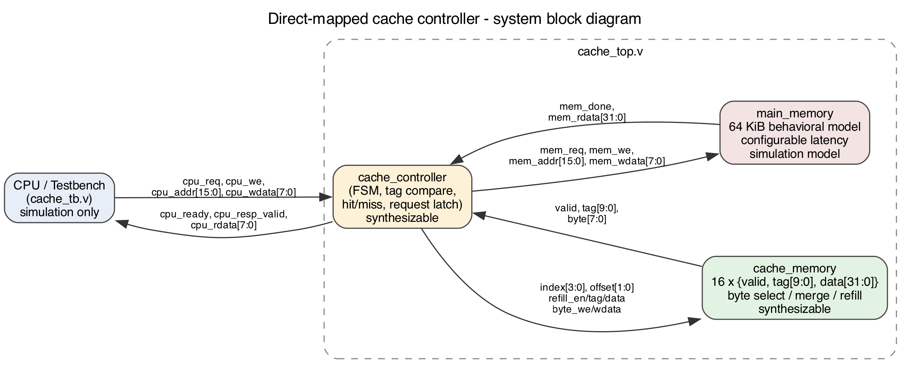
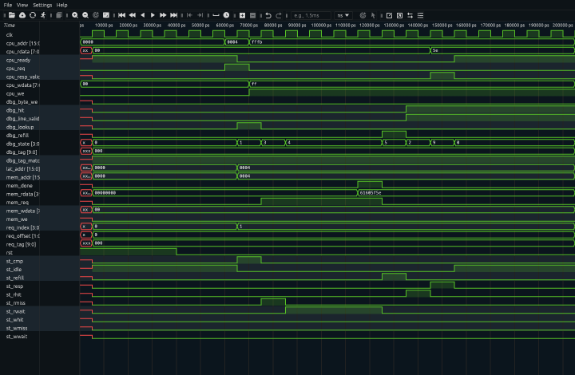
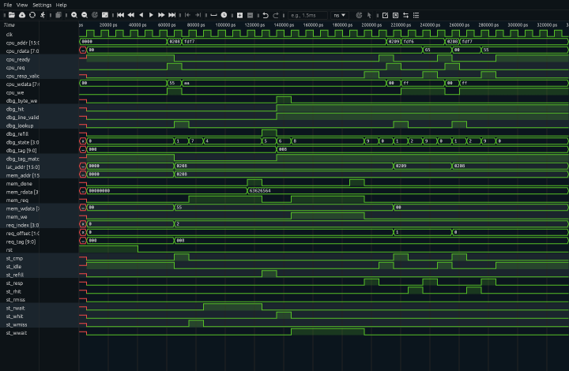

# Direct Mapped Cache Controller (Verilog HDL)

Design and implementation of a direct-mapped cache controller with a write-through / write-allocate policy, a behavioural
main-memory model and a thoroughly self-checking verification environment, in Verilog-2001, simulated with Icarus Verilog.

> **Status:** Phases 1-3 of the plan are complete (RTL, verification, report). Items that need the team are marked `[TODO]`:
> member names / enrollment numbers / contributions, repository URL, LICENSE holder, and the **demonstration video, which has not
> been recorded**. Nothing here has been run on an FPGA; there are no timing or area measurements, only simulation results and a
> synthesis-tool mapping estimate. See [PHASE_STATUS.md](PHASE_STATUS.md) and the [final audit](docs/final_audit.md).

## Specification

| Parameter | Value |
|---|---|
| Address / space | 16-bit byte address, 64 KiB |
| Cache | 64 B = 16 lines x 4 B, direct mapped |
| Tag / index / offset | `[15:6]` 10 b / `[5:2]` 4 b / `[1:0]` 2 b |
| Write policy | Write-through, write-allocate |
| Replacement | Overwrite the selected line on a conflicting miss |
| Controller | 10-state FSM, synchronous active-high reset |
| Storage | 688 bits (512 data + 160 tag + 16 valid) |
| Latency (cycles, `L` = memory latency) | read hit 3, read miss 5+L, write hit 4+L, write miss 6+2L |



Details: [architecture](docs/architecture.md) - [address decomposition](docs/address_decomposition.md) - [FSM](docs/fsm_design.md) -
[module interfaces](docs/module_interfaces.md) - [verification strategy](docs/verification_strategy.md) -
[IEEE report (PDF)](docs/IEEE_Project_Report.pdf) - [interview preparation](docs/interview_questions.md)

## Repository layout

```
rtl/            cache_controller.v  cache_memory.v  cache_top.v   main_memory.v (simulation model)
testbench/      cache_tb.v (Phase 1)  cache_tb_directed.v  cache_tb_vec.v  tb_common.vh  wave_probe.v  cache_top_varlat.v
verification/   reference_model.py  randomized_tests.py  performance.py  test_vectors/
scripts/        regression, mutation, synthesis review, report/figure generators, audit
docs/           architecture, FSM, interfaces, verification strategy, IEEE report (.tex/.pdf), contributions, interview Q&A, audit
diagrams/       block diagram, FSM diagram, plots (.dot / .png)
results/        saved logs, metrics, coverage, synthesis review, waveforms/ (VCD + Surfer screenshots)
video/          demo script, recording checklist, video-link placeholder
*.md            PHASE_STATUS  DEVELOPMENT_LOG  REQUIREMENTS_TRACEABILITY  TEST_RESULTS
```

## Tools

| Tool | Version used | Needed for |
|---|---|---|
| Icarus Verilog + VVP | 13.0 | simulation (required) |
| Python 3 | 3.14.5 | reference model, random tests, scripts |
| Yosys | 0.71 | synthesis check (optional) |
| Verilator | 5.054 | lint (optional) |
| Graphviz | 16.1.1 | diagrams (optional) |
| Tectonic | 0.17.0 | build the report PDF (optional) |
| matplotlib (in `.venv`) | 3.11.2 | report plots (optional) |
| Surfer | 0.7.0 | waveform viewing (GTKWave could not be installed in the development environment) |

macOS: `brew install icarus-verilog yosys verilator graphviz tectonic surfer`. Linux: `apt install iverilog yosys verilator graphviz gtkwave`.

## Reproduce the results from a clean checkout

```sh
make phase1        # compile (-g2001 -Wall, no warnings), simulate Phase 1 testbench, VCD + logs   (~2 s)
make phase1-all    # + latency sweep, mutation check, Yosys latch check
make phase2        # directed/edge tests at 22+5 latencies, reference model, random tests, mutation, waveforms, synthesis review, reports (~3 min)
make report        # rebuild docs/IEEE_Project_Report.pdf
make audit         # mechanical repository audit
make final         # everything above from a clean tree
```

Expected end of `make phase1`:
```
==== SUMMARY (MEM_LATENCY=4): PASS=122 FAIL=0 ====
RESULT: ALL TESTS PASSED
```
Expected in `results/reference_model_results.txt`: `TOTAL runs=357 passed=357 failed=0` and `RESULT: ALL COMPARISONS PASSED`.

## Actual results (from the saved logs)

| Check | Result | Evidence |
|---|---|---|
| Compile `-g2001 -Wall` (RTL and every testbench) | no warnings | header of `results/complete_test_results.txt` (0 warning lines), `results/phase1_compile_log.txt` |
| Phase 1 testbench | 122 checks, 0 failures | `results/phase1_test_results.txt` |
| Directed + edge tests (47 tests, 313 checks at L=4) | all pass | `results/complete_test_results.txt`, [TEST_RESULTS.md](TEST_RESULTS.md) |
| Same tests at 22 fixed memory latencies (0..16, 32, 64, 100, 255, 1000) and 5 random-latency configurations | all pass | `results/phase2_latency_sweep.txt` |
| Python reference model vs RTL | 357 runs, 714,666 transactions, 0 mismatches | `results/reference_model_results.txt` |
| Mutation check (28 injected RTL bugs) | 28/28 detected (22/28 by the earlier bench) | `results/phase2_mutation_results.txt` |
| Functional coverage | 10/10 states, 17/17 legal transitions, 16/16 indices, 4/4 offsets; **no line coverage measured** | `results/coverage_summary.md` |
| Synthesis tools | no latches; iCE40 mapper estimate 757 FF + 778 LUT4 (not an FPGA result) | `results/synthesis_review.md` |
| Reproducibility | clean rerun identical except timestamps | `PHASE_STATUS.md` |

### Performance (simulated cycles; synthetic workloads; L = 4; mean of 6 seeds)

| Workload | Hit ratio | Avg. latency (cycles) |
|---|---|---|
| uniform random | 0.001 | 10.50 |
| hot set | 0.379 | 8.46 |
| conflict-heavy | 0.163 | 9.49 |
| sequential | 0.589 | 6.47 |
| write-heavy | 0.245 | 11.54 |

Full tables and AMAT with assumptions: [results/performance_summary.md](results/performance_summary.md),
[results/performance_metrics.csv](results/performance_metrics.csv). No clock frequency is assumed.

## Screenshots (Surfer waveform viewer, not GTKWave)

| Cold miss and refill | Write miss with allocation |
|---|---|
|  |  |

All six scenarios, how they were produced and what was observed: [results/waveforms/README.md](results/waveforms/README.md).

## Limitations and future scope

Simulation only; functional (not line) coverage; one outstanding request, no pipelining, no write buffer; behavioural memory with a
16-bit latency counter; synthetic workloads; waveform viewer was Surfer. Future: victim cache, set-associative mapping, write buffer /
write-back, FPGA place-and-route, formal verification. Full lists: [PHASE_STATUS.md](PHASE_STATUS.md), report sections XIV-XV.

## Team and contributions

| Member | Name | Enrollment | Contribution |
|---|---|---|---|
| 1 | [TODO: name] | [TODO] | [TODO: actual contribution] |
| 2 | [TODO: name] | [TODO] | [TODO: actual contribution] |
| 3 | [TODO: name] | [TODO] | [TODO: actual contribution] |
| 4 | [TODO: name] | [TODO] | [TODO: actual contribution] |
| 5 | [TODO: name] | [TODO] | [TODO: actual contribution] |

See [docs/individual_contributions.md](docs/individual_contributions.md) (includes the AI-assistance disclosure that the team must complete) and
[docs/git_workflow.md](docs/git_workflow.md).

## Links

* Repository: [TODO: URL]
* Prototype video: [TODO: link - **not yet recorded**] ([script](video/demo_script.md), [checklist](video/recording_checklist.md))

## License

MIT (provisional; copyright holder to be confirmed) - see [LICENSE](LICENSE).
