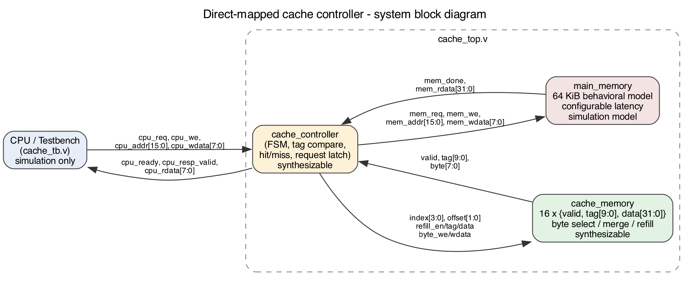
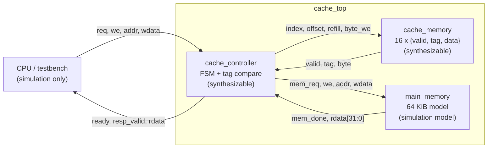

# Architecture

## Specification summary

| Parameter | Value |
|---|---|
| Address width / addressing | 16-bit, byte-addressable (64 KiB) |
| Cache capacity / lines / block | 64 B / 16 lines / 4 B (32-bit) |
| Tag / index / offset | 10 / 4 / 2 bits |
| Mapping | Direct mapped |
| Replacement | Overwrite the selected line on a conflicting miss |
| Write policy | Write-through, write-allocate |
| Controller | Finite-state machine, 10 states |
| HDL | Verilog-2001 |

Field derivation, storage overhead and byte ordering: [address_decomposition.md](address_decomposition.md).
FSM: [fsm_design.md](fsm_design.md). Signals and handshakes: [module_interfaces.md](module_interfaces.md).

## System block diagram

## Module responsibilities

| Module | Synthesizable? | Role |
|---|---|---|
| `cache_memory` | yes | Data/tag/valid arrays; combinational line read + byte select; synchronous whole-line refill; synchronous single-byte merge that preserves the other three bytes; synchronous reset clears all state |
| `cache_controller` | yes | Latches the CPU request, decodes tag/index/offset, compares tag and valid bit, runs the FSM, drives memory requests, refill and byte-update strobes, and the CPU response |
| `main_memory` | **no** (behavioral model) | 64 KiB byte array, deterministic init in an `initial` block, aligned 4-byte block reads, byte writes, configurable latency, single outstanding transaction |
| `cache_top` | yes (wiring) | Instantiates the three modules and exposes CPU ports plus debug ports. Contains `main_memory`, so as a whole it is a simulation top |

Separation of synthesizable RTL from simulation-only code: only `main_memory.v`
(initial block, 64 KiB array) and `testbench/cache_tb.v` are simulation-only.

## Behaviour summary

* **Read hit:** latch → compare → read byte from array → respond. No memory traffic.
* **Read miss:** latch → compare (miss) → fetch aligned 4-byte block → refill line
  (tag, valid, data) → read byte from array → respond.
* **Write hit:** latch → compare (hit) → update one byte in the array →
  write that byte to memory → respond when memory completes.
* **Write miss (write-allocate):** fetch block → refill → update byte → write byte
  to memory → respond.
* **Conflict miss:** the line is simply overwritten by the refill. Because the
  cache is write-through, memory is always up to date, so no write-back or dirty
  bit exists.

## Engineering decisions (recorded for traceability)

| # | Decision | Rationale |
|---|---|---|
| D1 | Synchronous active-high reset | Simple, race-free in simulation and maps to sync-reset flops (confirmed by Yosys `$_SDFF*` cells) |
| D2 | Byte-granular CPU interface (8-bit data) | The spec's hit/miss behaviour returns "the byte selected by the offset" and byte updates preserve other bytes |
| D3 | Single request/`done` handshake on the memory side; block read, byte write | Matches 4-byte block fills and byte-level write-through while keeping one bus |
| D4 | Memory `done` is a registered one-cycle pulse; memory ignores `req` while BUSY/DONE | Makes duplicate writes structurally impossible |
| D5 | Request latched on acceptance | CPU inputs need not be stable after the accept edge |
| D6 | Replay-as-hit after refill | No stale-data bypass path; write-allocate reuses write-hit logic |
| D7 | Little-endian block layout | Documented once; enforced in memory model and cache; mutation-tested |
| D8 | Deterministic memory init `(a[7:0]^a[15:8])+0x5A` | Reproducible; every byte in a block is distinct so byte-order/offset bugs are visible; adjacent blocks differ |
| D9 | Synchronous (blocking) write-through, no write buffer | Simplest correct policy; the CPU is stalled for memory latency on every write (performance trade-off, quantified in `results/performance_summary.md`) |
| D10 | Arrays (data/tag) also reset to 0 | Avoids X values in simulation and waveform; costs flip-flops with reset — acceptable at 16 lines |
| D11 | Hit/miss computed combinationally in `COMPARE_TAG` from the array read port | One-cycle lookup; array read is combinational (flip-flop based storage) |

## Known simplifications (see `PHASE_STATUS.md` for the full limitations list)

* One outstanding request; no pipelining or write buffer.
* Memory latency is fixed per run (parameter), not variable per access.
* Main memory is a behavioral model; no FPGA/ASIC timing or area is claimed.
