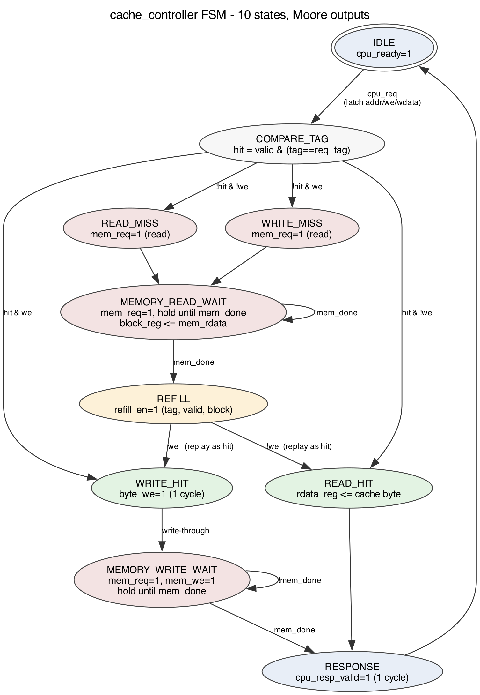

# Cache Controller FSM Design

Implemented in `rtl/cache_controller.v`. Style: three blocks — (1) state
register (`always @(posedge clk)`, non-blocking), (2) combinational next-state
(`always @(*)`, default `next_state = state`, `default:` branch), (3) datapath
registers (non-blocking). Outputs are **Moore** (functions of the state only),
except that the hit/miss decision made in `COMPARE_TAG` selects the next state.

Diagram: `diagrams/fsm_diagram.png` (source `diagrams/fsm_diagram.dot`).

## Encoding

4-bit binary. Codes 10–15 are unused and fall to `IDLE` via `default`
(recovery path; they cannot be reached in normal operation).

| Code | State |
|---|---|
| 0 | `IDLE` |
| 1 | `COMPARE_TAG` |
| 2 | `READ_HIT` |
| 3 | `READ_MISS` |
| 4 | `MEMORY_READ_WAIT` |
| 5 | `REFILL` |
| 6 | `WRITE_HIT` |
| 7 | `WRITE_MISS` |
| 8 | `MEMORY_WRITE_WAIT` |
| 9 | `RESPONSE` |

## Adaptations relative to the suggested state list

The ten suggested states are all used. Design decisions:

1. **Replay-as-hit after refill.** `REFILL` exits to `READ_HIT` or `WRITE_HIT`.
   A read therefore always returns data from the cache array *after* the refill
   (no bypass path, so it cannot return stale data), and a write-allocate write
   reuses the normal byte-update + write-through path. This removes duplicated
   logic.
2. **`READ_MISS` and `WRITE_MISS`** are both one-cycle "issue block fetch"
   states with identical outputs. They are kept distinct so the waveform and
   future statistics show *which* kind of miss occurred.
3. **Request latch.** The request is latched in `IDLE`, so the CPU can drop or
   change its inputs after acceptance.
4. **Registered block.** The block returned by memory is held in `block_reg`
   during `MEMORY_READ_WAIT` and written into the cache in `REFILL`
   (one extra cycle, clean separation of memory timing from the array write).

## State table

Notation: `hit = cache_valid && (cache_tag == req_tag)`; `we = req_we` (latched).

| State | Purpose | Entry | Exit (next state) | Outputs asserted | Data movement | Wait behaviour |
|---|---|---|---|---|---|---|
| `IDLE` | Wait for request | reset; after `RESPONSE` | `cpu_req` → `COMPARE_TAG` | `cpu_ready` | On `cpu_req`: latch `req_addr/req_we/req_wdata`; clear `rdata_reg` | Stays while `!cpu_req` |
| `COMPARE_TAG` | Hit/miss decision | from `IDLE` | `hit&!we`→`READ_HIT`; `hit&we`→`WRITE_HIT`; `!hit&!we`→`READ_MISS`; `!hit&we`→`WRITE_MISS` | (`dbg_lookup`) | Cache read port selects line `req_index` | 1 cycle, no wait |
| `READ_HIT` | Return the byte from the array | hit on read, or refill on read | → `RESPONSE` | – | `rdata_reg <= cache_byte` | 1 cycle |
| `READ_MISS` | Start block fetch (read) | miss on read | → `MEMORY_READ_WAIT` | `mem_req`, `mem_addr = block base` | – | 1 cycle |
| `WRITE_MISS` | Start block fetch (write-allocate) | miss on write | → `MEMORY_READ_WAIT` | `mem_req`, `mem_addr = block base` | – | 1 cycle |
| `MEMORY_READ_WAIT` | Wait for the block | from `READ_MISS`/`WRITE_MISS` | `mem_done` → `REFILL` | `mem_req` (held), `mem_we=0` | On `mem_done`: `block_reg <= mem_rdata` | Stays until `mem_done`; request pins held stable |
| `REFILL` | Install block in the line | from `MEMORY_READ_WAIT` | `!we`→`READ_HIT`; `we`→`WRITE_HIT` | `cache_refill_en` | `data[idx] <= block_reg; tag[idx] <= req_tag; valid[idx] <= 1` | 1 cycle |
| `WRITE_HIT` | Update the byte in the cache | hit on write, or refill on write | → `MEMORY_WRITE_WAIT` | `cache_byte_we` | Replace byte `req_offset` of the line with `req_wdata`, keep other 3 bytes | Exactly 1 cycle ⇒ exactly 1 cache update |
| `MEMORY_WRITE_WAIT` | Write-through the byte | from `WRITE_HIT` | `mem_done` → `RESPONSE` | `mem_req`, `mem_we`, `mem_addr = req_addr`, `mem_wdata` (held) | Byte goes to main memory | Stays until `mem_done`; memory commits once |
| `RESPONSE` | Signal completion | from `READ_HIT` or `MEMORY_WRITE_WAIT` | → `IDLE` | `cpu_resp_valid` | `cpu_rdata = rdata_reg` | 1 cycle |

## Paths

* **Read hit:** `IDLE → COMPARE_TAG → READ_HIT → RESPONSE → IDLE`
* **Read miss:** `IDLE → COMPARE_TAG → READ_MISS → MEMORY_READ_WAIT → REFILL → READ_HIT → RESPONSE → IDLE`
* **Write hit:** `IDLE → COMPARE_TAG → WRITE_HIT → MEMORY_WRITE_WAIT → RESPONSE → IDLE`
* **Write miss:** `IDLE → COMPARE_TAG → WRITE_MISS → MEMORY_READ_WAIT → REFILL → WRITE_HIT → MEMORY_WRITE_WAIT → RESPONSE → IDLE`

## Replacement, write policy, tag/valid checking

* **Tag/valid check.** A line hits only if `valid && tag == address[15:6]`. After
  reset all valid bits are 0, so every first access to a line is a cold miss.
* **Replacement.** Direct mapped: there is no choice of victim. A miss on a
  valid line with a different tag (conflict miss) simply overwrites that line in
  `REFILL`. No dirty bit or write-back is needed because the cache is
  write-through (memory is always current).
* **Write-through.** Every write — hit or allocated miss — updates the cache and
  then writes the byte to main memory; the CPU is stalled until the memory write
  completes (no write buffer).
* **Write-allocate.** A write miss first fetches the whole block (so the other 3
  bytes are valid), installs it, then performs the byte update + write-through
  as in a write hit.

## Latency derivation (cycle 0 = accept edge, `L` = memory latency)

| Path | Cycle-by-cycle | Response sampled at |
|---|---|---|
| Read hit | 1 `COMPARE_TAG`, 2 `READ_HIT`, 3 `RESPONSE` | 3 |
| Read miss | 1 `COMPARE_TAG`, 2 `READ_MISS` (memory sees `mem_req`), `mem_done` in cycle 2+L, 3+L `REFILL`, 4+L `READ_HIT`, 5+L `RESPONSE` | 5+L |
| Write hit | 1 `COMPARE_TAG`, 2 `WRITE_HIT`, 3 `MEMORY_WRITE_WAIT` (mem sees req), `mem_done` in 3+L, 4+L `RESPONSE` | 4+L |
| Write miss | 1 `COMPARE_TAG`, 2 `WRITE_MISS`, `mem_done` in 2+L, 3+L `REFILL`, 4+L `WRITE_HIT`, 5+L `MEMORY_WRITE_WAIT`, `mem_done` in 5+2L, 6+2L `RESPONSE` | 6+2L |

Verified by the testbench monitor on every transaction at 22 fixed memory
latencies (L = 0 [clamped to 1] .. 16, 32, 64, 100, 255, 1000) and with a
pseudo-random per-transaction latency (`results/phase2_latency_sweep.txt`).

**Wait-state durations (test D-25).** `MEMORY_READ_WAIT` lasts exactly `L` cycles
(the request starts one state earlier, in `READ_MISS`/`WRITE_MISS`), whereas
`MEMORY_WRITE_WAIT` lasts `L + 1` cycles (the memory first sees the request in the
first cycle of that state and `mem_done` arrives `L` cycles later). Consequently at
`L = 1` the `MEMORY_READ_WAIT -> MEMORY_READ_WAIT` self-loop never occurs.

## Wait-state safety (duplicate writes, premature responses)

* The cache byte update happens in `WRITE_HIT`, which lasts exactly one cycle.
* The memory write is committed once by `main_memory` when it enters `DONE`; the
  controller holds `mem_req` through the `mem_done` cycle only, and the memory
  ignores `mem_req` while `BUSY`/`DONE`.
* `RESPONSE` is reachable only through `mem_done` (miss/write paths) or
  `READ_HIT`; the monitor checks the exact count of memory operations per
  transaction before each response.
